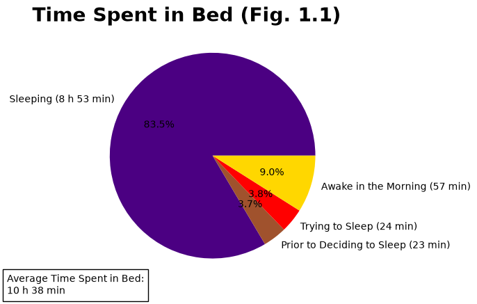
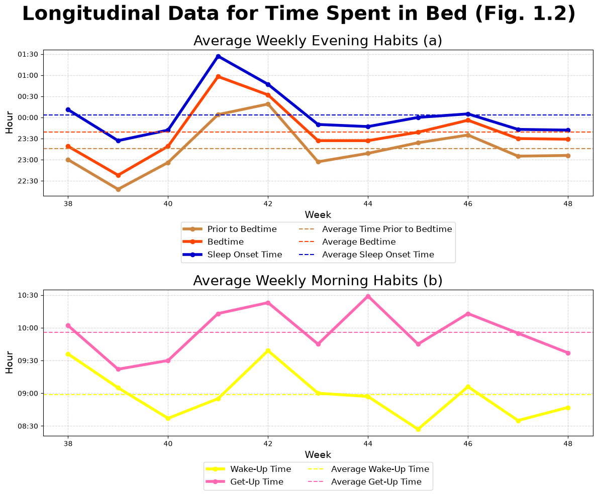
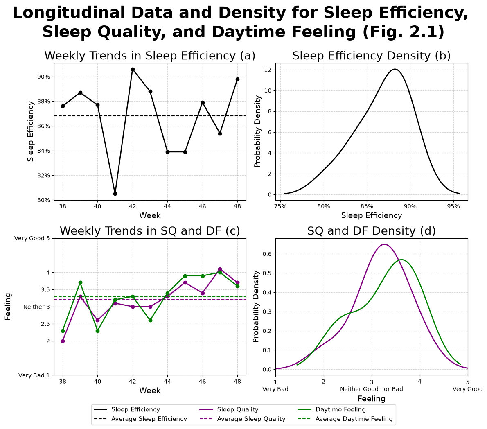
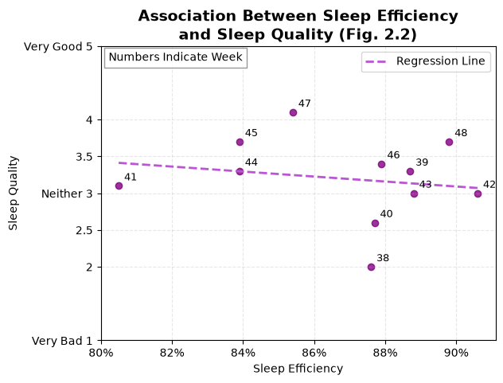
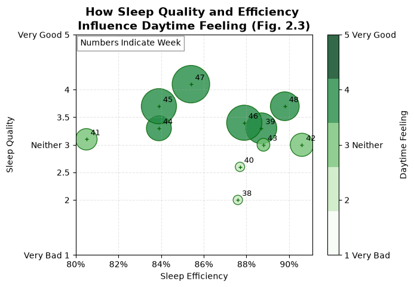
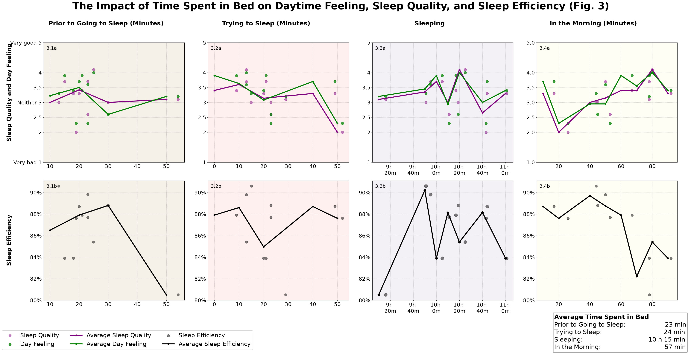

# Personal Sleep Statistics (Exam for PSY-3035) 
### Marie Bøe Aaberg
This document is for the text and figures associated with the exam. For the full exam with code please refer to the document "Exam". For code please refer to the document "Code Only". For the dataset please refer to the document "sleep_avg".

For this exam I have chosen to use my own recorded sleep statistics containing information on my personal sleep health and habits. This was chosen as it allows me to gain a better understanding of my own efforts to improve my overall health and monitor which applied changes make an impact on my sleep. The presented figures thus monitor various aspects of this journey in hopes of observing improvements aswell as negative changes that allow me to reflect around why and through that alter my sleep habits if necessary. Despite active efforts to improve my sleep, the data may not show consistent improvement or clear patterns over time. This may be influenced by several confounding factors, particularly my chronic pain, which is not being tracked and therefore cannot be accounted for in the analyses.

Explanations of the code will mainly be provided on the same line as said code, but will be further elaborated on afterwards when relevant. Most code will only be commented on the first time it appears to reduce clutter. #===#X Is utilized as to make it easier to find sections within the code. A keyword is added at the end(x) for further convenience.

AI has throughout this exam been used to code time conversion. Although some other sources were available for this code (pandas.Timedelta, 2026; Time deltas, 2026), I found them difficult to understand and make use of. I have therefore decided to leave in the AI code while providing the original source material I asked it to base it on.

Additionally the exam will state that hypotheses are confirmed or rejected. Although such conclusions based on limited figures alone would be wrong in more comprehensive studies and words like supported/not supported should be utilized instead, I have still chosen to use this terminology for convenience as it fulfills exam requirements (2.3 and 4.2 on rubric).

---

## 1. Time Spent in Bed
### 1.1 Overall Time Spent in Bed
I do not have any hypotheses regarding overall time spent in bed. My goal with this figure is to track how much time I spend in bed in total, and how that time is spent. It will not track any changes, but allows me to optimize if the overall results skews too much in an unfavorable direction.

#### Why a Pie Chart?
A pie chart (Simply Coding, 2020) was chosen as it shows how much of my time in bed is spent either awake in the evening (bedtime & prior to it), sleeping, or awake in the morning. Time awake in the evening has been split into two sectors as time spent in bed without the intention to fall asleep (e.g. reading a book) differs greatly from time spent in bed with the intention of going to sleep. Later figures will analyse how these variables impact sleep health. In the dataset there is already a variable for time spent in bed(ST), but as it is mainly used for mathematical reasons regarding sleep and sleep efficiency it does not account for time spent in bed not intending to sleep. The prior to bedtime sector is not necessary, but as the figure is utilized to get an overarching picture of my habits I deemed it valuable to include. Average time spent in bed is thus calculated including the prior to bedtime sector and not by utilizing ST.

#### Color Choices
Although brown(sienna) and red (Hunter et al., 2026a) are very similar and possibly thus a bad choice, I have still chosen them to represent time awake in the evening. Here I value the similarity in color representing the same part of the day over visibility for those with color vision impairments. The ability to differenciate certain colors is deemed as less important in this instance as there are percentages representing the values (Simply Coding, 2020). Red tones have been chosen as longer time spent in bed prior to sleep is generally regarded as a negative for good sleep hygiene. Time spent in bed trying to sleep is thus red as to indicate it being worse for sleep health than time otherwise spent in bed during the evening (assuming no technology is being used) which has been labelled using brown for that reason.

Indigo has been chosen for sleep as it is a dark calming color frequently associated with sleep. Meanwhile yellow (Hunter et al., 2026a) has been chosen for the opposite reason as it is vibrant, inviting, and stimulating, something usually welcomed in the morning. All colors except the red/brown evening combination are to my knowledge accessible for the color impaired (Phillips, 2022).

#### Additional Visual Choices
Percentages have been chosen as they made a lot of sense to use for a general idea of how much each sector occupies overall time spent in bed. Average amount of time per sector has been added to the slice name to avoid clutter (Simply Coding, 2020). Only time spent sleeping has been given hours and minutes as the other slices do not require hours. Additionally, text has been added to include the overall average time spent in bed. This additional text was logical to have on the bottom left, and has been given its own box without any filler color to avoid confusion and to make the overall visual more appealing (Hunter et al., 2026e; Kimberly Fessel, 2021).

---
### 1.2 Longitudinal Data for Time Spent in Bed
In addition to measuring the overall time spent in bed it may be valuable and interesting to measure the timepoints for when I got into bed(S1), when i decided to go to sleep(S2), sleep-onset time(S3), wake-up time(M1), and time of getting out of bed(M2) to see whether this stays stable, improves, or degrades. I have therefore made two line graphs with averages to measure longitudinal changes.
#### 1.2.a Evening Habits
The line graphs for the evening habits measure when I have gotten into bed without the intention of going to sleep(Prior to Bedtime), when I have decided to go to sleep(Bedtime), and Sleep Onset Time. In accordance with this I expect to see a positive correlation between average weekly time in bed prior to bedtime, bedtime and sleep onset time (H1) as you have to be in bed to decide to go to sleep and you need to have decided to go to sleep to fall asleep. I further expect to see that the time between average weekly bedtime and average weekly sleep onset time eventually stabilizes as more datapoints are added resulting in a difference consisting of 10 minutes or less between bedtime and sleep onset time(H2). In line with this I expect my bedtime to stabilize to be roughly within the average bedtime(H3) as my sleep schedule improves and more data entries are added (e.g. Bedtime is consistently between 23:00 and 00:00 while the average is 23:30).

#### 1.2.b Morning Habits
The line graph for the morning habits measures when I wake up(Wake-Up Time) and when I get out of bed(Get-Up Time). As with the evening habits I expect my average weekly wake-up time to positively correlate with my average weekly get-up time(H4) since you cannot get out of bed before you have woken up. Similarly to evening habits I expect my average weekly wake-up time to stabilize over time(H5) as more data is entered and my sleep hygiene improves. However, morning habits diverge from evening habits in that I expect no consistent pattern in this figure for average weekly get-up time beyond a positive correlation with wake-up time(H6). This lack of pattern is expected as my chronic condition demands me to start my day differently depending on pain levels. This may become apparent in later figures as this time spent in bed in the morning may be impacted by sleep quality, or impact daytime feeling.

#### I therefore hypothesize that:
H1: The time between average weekly bedtime and average weekly sleep onset time will eventually stabilize to be 10 minutes apart or less.

H2: Average weekly bedtime stabilizes as more data is introduced.

H3: Average weekly wake-up time stabilizes as more data is introduced.

H4: Average weekly get-up time has no consistent pattern beyond a positive correlation with wake-up time.

#### Results
The duration between bedtime and sleep onset time(H1, figure a) trends towards a smaller gap suggesting that currently applied methods are beneficial. H1 can therefore within the scope of the exam be confirmed. No similar hypothesis has been made regarding time spent in bed prior to bedtime as this time is meant to be open for intentionally including longer durations, and does not record insominac tendencies. Similarly to time spent trying to sleep, bedtime (H2, figure a) stabilizes as more data is introduced with the data settling nicely along the average bedtime thus confirming H2. Wake-up time however (H3, figure b) does not show the same progression with wake-up time varying greatly and H3 cannot be confirmed for this exam. The get-up time varies greatly from wake-up time (H4, figure b) in terms of how long it is between the two time points, which is expected due to non-sleep related health reasons. Figure b suggests that there may be a weak correlation beyond get-up time coming after wake-up time, but more data entries are needed. Nontheless, H4 is confirmed as the time spent in bed in the morning ranges from less than 30 minutes to as much as an hour and thirty minutes. It is expected that this lack of consistency continues as more data is collected, and when related concepts are analyzed in later figures. The figures additionally show positive correlations between the time prior to bedtime, bedtime, and sleep onset time, as well as wake-up time and get-up time. This has however not been hypothesized on as common sense dictates that you cannot decide to sleep before going to bed, go to sleep before deciding to sleep, nor get out of bed before waking up.

#### Why Line Graphs?
Line graphs for evening and morning habits are being used in order to have a better understanding of how these habits evolve throughout the weeks (Visually Explained, 2025). This allows for systematically introducing new habits and noting whether they have a positive or negative impact, if they have any at all. By taking particular interest in bedtime and sleep onset time the evening habits graph (figure a) allows me to track my sleep tendencies and record when (or if) insomniac traits re-emerge. These traits are apparent in the graph prior to week 40 when the introduction of an effective new sleep hygiene habit was introduced. Evening and morning habits have been made into two seperate subplots within the same figure as plotting them together in the same subplot offers no benefits while incorporating all waking hours into the plot and thus creating visual clutter and confusion. However, they are put in the same figure as they are natural to group together. Averages have been added with the intention of better understanding my habits once there are sufficient data entries. The ideal is for the average bedtime and wake-up time to closely align with the weekly averages as per H3 and H5.

#### Color Choices
Colors have been chosen according to the colors used in the "Time Spent in Bed" pie chart in order to have visual consistency, while being slightly different due to it not being the exact same concept (i.e. sleep vs. sleep onset time). Evening habit colors are therefore in similar colors as time spent awake in bed in the evening and while sleeping. The "Prior to Bedtime" line gets a lighter brown(peru) to align with the brown(sienna) given to the "Awake in the Evening: Prior to Bedtime" sector in the above pie chart. Similarly "Bedtime" is given a reddish orange color(orangered) to align with the red(red) given to the "Awake in the Evening: Bedtime" sector. As well as "Sleep Onset Time" getting a blue color(mediumblue) to represent the time sleep occurs and thus aligning it with the "Sleep" sector consisting of a deep blue-ish color(indigo). Although this figure runs into the same issue as the pie chart where brown and red may impair peoples ability to differenciate the two, the nature of their content make for a natural assumption that "Prior to Bedtime" comes prior to "Bedtime" (Hunter et al., 2026a; Phillips, 2022).

Like with the evening habits the morning habits get colors aligning with the "Awake in the Morning" sector of the "Time Spent in Bed" pie chart. "Wake-Up Time" is given a yellow color(yellow) to align with the pie chart yellow color(gold). "Get-Up Time" is however not included in the pie chart and is thus given a contrasting color(hotpink) to accomodate for color vision impairments (Hunter et al., 2026a; Phillips, 2022).

#### Additional Visual Choices
A figure title has been added and made bold for visual clarification (Kumar, 2026).

Another visual choice that is introduced in these figures is a grid (Grids in Matplotlib, 2026). This is added for practical reasons which will grow in importance as the dataset expands. The grid is also made to be 50% transparent as to not take up too much visual space and distract from the presented information. Along with the grid the plt.legend() has been added to give adequate information on what the various lines are for (Hunter et al., 2026c). This has been modified to be a box below the figure consisting of both the line and the corresponding average per coded line to make it visually pleasant without taking up too much space or interupting anything within the figure such as overlapping with the graph lines. Additionally each datapoint has been accentuated with a circular dot to make the graph more accessible to read.

Although it may not translate a userwarning appears. However, this userwarning does not seem to have an impact on the outcome and has thus been left alone.

---

## 2. Sleep Characteristics and Well-Being
### 2.1 Longitudinal Data for Sleep Characteristics and Well-Being
In this figure I am interested in exploring whether there is any development in sleep efficiency(SE), sleep quality(SQ), and daytime feeling(DF). Of particular interest is sleep efficiency below 85% as this is below the healthy boundaries for an adult (≥85%). With the expectation that sleep efficiency is within healthy boundaries it is not necessary to achieve higher sleep efficiency through targeted action and improvement is thus not hypothesized on. Sleep quality and daytime feeling however are expected to be lower than ideal with the goal of both sleep quality and daytime feeling to gradually improve over time. I therefore hypothesize that:

H5: Sleep Efficiency consistently stays above 85%.

H6: Average weekly Sleep Quality (H6A) and average weekly Daytime Feeling(H6B) increases over time.

Density plots are added mostly to show a range in coding and visualization abilities, but it also supplements the average lines in figures a and b. Although it is beneficial to better understand my sleep efficiency, sleep quality, and daytime feeling patterns through knowledge of densities I do not have any hypotheses regarding the results.

#### Results
The line graph for weekly sleep efficiency(figure a) show a less consistent pattern than expected. Particularly week 41 as a clear outlier which is a result of a poor performing sleep hygiene habit being introduced and promptly removed. In spite of this the average sleep efficiency is above 85%, as is further confirmed by the highest densities in figure b showing the highest values between 85 and 95%. H5 can thus be confirmed.

Figure c shows a positive growth with both SQ and DF values somewhat consistently increasing over time. H6 can thus be confirmed even though it is not as strong of a growth as hoped for. The rather small improvement of SQ and DF in the span of several months with active attempts to improve sleep may suggest that although sleep hygiene improves — which makes sleep health more reliable and thus reducing the wide span in reported SQ and DF — there may be underlying undiagnosed health concerns (e.g. disturbed deep sleep) which impact the reported SQ and DF. This is particularly likely as sleep efficiency in figures a and b are mostly within normal boundaries.

#### Why Line Graphs and Density Plots?
Line graphs were chosen for figure a and c in order to map the development of SE, SQ, and DF. It gives a clear view of whether progress is being made (Visually Explained, 2025). Additionally SQ and DF have been plotted together since they utilize the same values unlike SE relying on percentages. This is done both to reduce space and to get an idea of how they correlate. By looking at figure c it is possible to see a positive correlation, which is expected as daytime feeling at least partially depends on sleep quality.

The density plots in figures b and d were chosen as they further improve the understanding of current sleep characteristics and well-being while showing a wider variety of coding abilities. Density plots were chosen as they provide a more continuous representation of the data distribution than, for example, a bar graph does (Density Plots with Pandas in Python, 2025). This makes it possible to observe the underlying growth pattern between each 5% increase point, albeit in a smoothed form. These patterns would otherwise be less apparent or potentially obscured when using a bar graph.

#### Color Choices
As with previous figures the colors have been chosen to maintain color consistency. Sleep Efficiency has been made black and Sleep Quality has been made purple to align with the darker blue hue theme associated with sleep whereas Daytime Feeling has been made green to align with the bright and awake yellow theme for morning habits and by extension daytime feeling. Green was chosen as there are limited yellow hues that are appropriate for figures while remaining clear and visible, aswell as it contrasting well with purple for the color impaired. Yellow-purple contrasts far less as it may trigger blue-yellow colorblindness despite the warmer tone in the purple, and green is thus a far more natural choice given the overarching color themes and accessibility needs (Hunter et al., 2026a; Phillips, 2022).

#### Additional Visual Choices
The grid remains the same as in figure 1.2 for the same reasons (Grids in Matplotlib, 2026). The legend however is placed outside of the subplots as to prevent repetition and unnecessary clutter (Hunter et al., 2026c). The plot title uses abbreviations for sleep quality(SQ) and daytime feeling(DF) to shorten the length in order to keep the figure visually appealing, maintain an appropriate title fontsize, and reduce deadspace. A main title has also been added to make the figure appear more structured (Kumar, 2026).

Due to the original scale for SQ and DF ranging from 1(very bad) to 5(very good) the axes in figures c and d have been altered to include all five values despite no datapoints being above or below 2-4. Due to the datapoints being consentrated within these values I decided to add 2.5 and 3.5 to the y-axis in figure c to make the plot more accessible. 1.5 and 4.5 have not been added as to reduce unecessary visual clutter (Matplotlib.pyplot.yticks(), 2025). 2.5 and 3.5 has not been added to the density plot in figure d for the same reason as the additional information does not prove any significant value in this figure and has thus been cut. Since the values 1-5 mean nothing on their own I have added additional information to the values 1, 3, and 5 to help the viewer make sense of the numbers. An alternative option was to have a plt.text() on the side but I felt this took more away from the figure than adding the name of the values for very bad(1), neither good nor bad (3) which is also referred to as neutral to save space, and very good (5). The values between thus become self explanatory and would just add clutter.

### 2.2 How Sleep Efficiency Influences Sleep Quality
As sleep characteristics and wellbeing are the best measures I have of how well my sleep journey is going it is also interesting to look beyond weekly changes and explore how sleep efficiency impacts sleep quality. Since sleep quality is a subjective measure of experience based on how I feel about my sleep and sleep efficiency is calculated based on recorded data, it is reasonable to believe that sleep quality to some extent follows sleep efficiency. I would therefore like to examine whether there is any correlation between the two and which direction this correlation goes. As a healthy adults sleep efficiency is within healthy normal boundaries at 85% i expect a positive correlation between sleep efficiency and sleep quality up until this point. I believe this correlation will stay positive past this cutoff point, but possibly to a lesser extent which is why i hypothesize that:

H7: Sleep Quality positively correlates with Sleep Efficiency.

#### Results
The figure shows an unclear relationship between sleep efficiency and sleep quality. In spite of this the regression line is slightly negative although this could be due to the lack of scatter points below 84%. Even with an unreliable regression line the scatter points indicate that sleep efficiency is overall good while sleep quality centers between the values 3 and 4(somewhat good) on the sleep quality scale. The averages and densities in figure 2.1 further support this. The figure therefore suggests that there are confounding variables that impacts sleep quality far more than sleep efficiency does. This somewhat surprising result may likely be from factors such as previously mentioned health concerns, particularly since anything above 85% sleep efficiency is considered normal. H7 should thus be rejected based on the currently existing information.

#### Why a Scatter Plot With a Regression Line?
A scatter plot was chosen since it shows the relationship between the two variables (sleep efficiency and sleep quality) allowing me to determine whether there is a correlation. Although there is no clear and reliable relationship between the two as of now I still chose to include a regression line (Bro Code, 2025; Karina Adcock, 2023; Stojiljković, 2024). This was partly to be able to explore the code and partly in hopes of it becoming useful at a later time when more data is added.

#### Additional Visual Choices
Purple has been chosen to maintain color consistency for sleep quality. The regression line is a slightly lighter purple (mediumorchid) and a dotted line rather than a full one to create a slight visual contrast without overpowering the scatter points (Hunter et al., 2026a; Phillips, 2022; Stojiljković, 2024). The grid and axis parameters are kept the same as in previous figures due to it working well and improving readability. A textbox to explain the enumeration has been added to the top left as this is an unlikely place for future scatter points and to avoid making the enumeration longer than necessary (Hunter et al., 2026e; Kimberly Fessel, 2021). The legend for the regression line was naturally placed in the top right corner by the program and did not pose any obvious challenges so it was kept as is (Hunter et al., 2026c).

### 2.3 How Sleep Quality and Efficiency Influence Daytime Feeling
In addition to believing that sleep quality follows from sleep efficiency I believe that daytime feeling follows from these two factors. This is because daytime feeling is a subjective reporting of how i felt the following day. There may of course be many confounding variables such as pain levels, unrelated stress, and accumulated exhaustion, but nontheless i believe that an effective good nights sleep leads to better daytime feeling and thus hypothesize that:

H8: Daytime Feeling improves as Sleep Quality(a) and Sleep Efficiency(b) improves.

#### Results
The figure shows similar results as with sleep quality in figure 2.2. Sleep Efficiency remains good while both sleep quality and daytime feeling stay at between the neither good nor bad(3) and somewhat good(4) marks. Although this is not an unexpected find considering the results in figure 2.1 with the densities accumulating between the values of 2 and 4 there is still a surprising find in that some of the higher daytime feeling scores center around the lower recorded sleep efficiency scores. This however is not the case with the impact of sleep quality on daytime feeling where higher sleep quality scores indicate better daytime feeling scores. This result suggests that there is a correlation between sleep quality and daytime feeling, but that sleep efficiency does not impact daytime feeling enough to take into consideration (barring extreme efficiency values). H8a regarding sleep quality should therefore be confirmed while H8b regarding sleep efficiency should be rejected.

#### Why a Bubble Chart?
A bubble chart was chosen for this figure as it has the same benefits as a scatter plot in that it allows for analyzing the relationship between variables, but with the addition that you can alter the size and color of the bubble to allow for a third variable (Karina Adcock, 2021; Ms. Simmons' Math Class, 2025; Ryan Noonan, 2018). Which in this instance is daytime feeling based on both sleep quality and sleep efficiency rather than just one or the other.

#### Additional Visual Choices
Green was chosen to maintain color consistency for daytime feeling with darker greens indicating higher daytime feeling scores as those are the desireable scores I would like for the eye to naturally gravitate towards (Hunter et al., 2026a; Phillips, 2022). The bubbles were also given a rather extreme size difference to make it clear which daytime feeling score they got as people may struggle to differenciate some of the color gradients. The gradient has been made into five distinct colors rather than a continious gradient to further highlight what scores the bubbles represent. This gradient is explained through a vertical colorbar on the rigth hand side of the figure rather than a horizontal colorbar below the figure as it looks natural there and makes the scale fit with the sleep quality scale (Karina Adcock, 2021; Ms. Simmons' Math Class, 2025). The only downside with this choice is that the label for the colorbar is also vertical and somewhat inconvenient. However, putting it horizontal anywhere in the figure proved difficult and made the figure to look cluttered and weird. Additionally a secondary scatterplot consisting of plus signs have been added to the code to make the exact location of the larger bubbles easier to pinpoint. Grids, explanatory text for the enumeration, and the parameter choices have been made the same as in previous figures for consistency and convenience.

---

#### 3. Sleep Characteristics and Well-Being in Relation to Time Spent in Bed

Lastly I would like to look at how time spent in bed impacts sleep efficiency, sleep quality, and daytime feeling. As sleep quality was found to not be particularly impacted by sleep efficiency in figure 2.2 it seems particularly valuable to measure both. Due to the nature of the sleep quality and daytime feeling scales it is then also natural to add daytime feeling to the sleep quality plots even though it at least partially follows sleep quality. Daytime feeling may still give some interesting and unexpected results and since it can easily be implemented in the code it is natural to include it. Since the pie chart in figure 1.1 is split into the four categories of time spent in bed prior to going to sleep, trying to sleep, sleeping, and time spent in bed in the morning it is thus also natural to include all four of these time points in the figure.

As I have no idea of how time spent in bed prior to going to sleep might impact sleep efficiency, quality and daytime feeling I would like to keep those two subplots as exploratory. This time is spent winding down and trying to not use technology so there should not be any extreme correlations. I am also interested in seeing how long my ideal sleep duration is by examining at what amount of time spent sleeping I report the highest sleep efficiency, quality, and daytime feeling. I dont have any hypotheses beyond an expectation that it is higher than the average person and thus choose to leave these two subplots as exploratory aswell.

In the subplots for trying to sleep however I expect to see a negative correlation between time spent trying to sleep and these three sleep characteristics(H9). Additionally i believe that the subplots for time spent in bed in the morning will be at their highest around the relatively moderate reported minutes spent in bed in the morning(H10). I believe this as i experience less pain when i can have slow mornings where i spend some time in bed after waking up so getting out of bed quickly should lead to worse well-being. However I do not believe the shorter times spent in bed in the morning to be significantly worse than the moderate amount of time as it is subsequent to sleep and thus lacking a significant relationship with the sleep characteristics and well-being, particularly the sleep quality and efficiency. What I do believe though is that these variables will be reported as significantly worse when I spend a lot of time in bed in the morning, meaning the highest reported durations. This I believe as on the days where I have poor sleep I experience more pain and would thus need longer in bed to feel I can get on with my day with the least amount of trouble. For time spent in bed trying to sleep and time spent in bed in the morning i therefore hypothesize that:

H9: The longer time spent in bed trying to sleep, the worse the sleep efficiency(a), sleep quality(b), and daytime feeling(c)

H10: Sleep efficiency(a), sleep quality(b), and daytime feeling(c) are at their highest around the personal moderate amount of time spent in bed in the morning.

#### Results
The results in subplot 3.1a show that time spent in bed prior to going to sleep does not impact sleep quality or daytime feeling whatsoever unlike the results in subplot 3.1b where sleep efficiency is at its highest around the thirty minute mark before rapidly declining. However, the scatter plot shows that the vast majority of scatter points appear before that thirty minute mark so any change in the line graph after this point is far too unreliable to be considered. The overall picture for the 3.1 subplots is thus that my current habits of spending between 10 and 30 minutes in bed doing a calm activity such as reading is a net positive for my sleep health.

As for the 3.2 subplots regarding the time I spend trying to sleep the scatter points are slightly more evenly distributed across the recorded duration times. Most scatter points still appear before the thirty minute mark making it difficult to deny or confirm the hypothesis(H9). However, both sleep quality and daytime feeling report mostly parallell data entries where there is a sharp decline after 40 minutes of trying to sleep. Prior to this the scatter points vary greatly between 2 and 4 on the feeling scale but does seem to have a small decline the longer I spend trying to sleep. This suggests that H9b and H9c may in the future be confirmed but as of now it lacks the entries to confidently be assessed. Subplot 3.2b regarding sleep efficiency tells a different story. Here the scatter points have a larger sprawl on the y-axis resulting in a line that drastically drops between 10 and 20 minutes before improving as the time spent trying to sleep grows. This steady increase is likely due to there being few data points after 30 minutes which show a surprisingly good sleep efficiency, something that may change if or when more data entries of struggling to sleep are added. This however is unlikely as figure 1.2a shows a steady decrease in time spent trying to sleep as the weeks go on, further supported by the scatter points centering around the 20 minute mark in subplots 3.2 with the average time spent trying to sleep being recorded as 24 minutes. It is therefore unlikely for the line graph to decrease at the higher durations, but it may still show that sleep efficiency is best when around 10-20 minutes. However, with previous figures along with all the subplots in the current figure showing unreliable results I am tempted to conclude with H9a being confirmed under suspicion until more data entries give a clearer image.

The next two subplots regarding time spent sleeping(3.3) show a more varied result than anticipated, although as with other figures this is likely due to the lack of data entries and confounding variables. Regardless subplot 3.3a for daytime feeling and sleep quality show that between 10 hours and 10 hours 20 minutes is a good amount of sleep for me despite the drastic decline at 10 hours and 10 minutes. Subplot 3.3b for sleep efficiency however suggest that roughly 9 hours and 40 minutes is ideal. Although the 3.3 subplots are rather inconsistent both plots suggest that around 10 hours of sleep may be a good amount of sleep for me. Based on this figure I should thus aim for 10 hours of sleep as a starting point and then reassess in a few weeks for an improved sleep health.

Lastly time spent in bed in the morning also shows a significant difference between sleep quality and daytime feeling (3.4a), and sleep efficiency (3.4b). Daytime feeling and sleep quality show quite parallell lines that with the occasional dip increases with time spent in bed in the morning. The scatter points are also scattered enough throughout the x-axis to better support this line development than in some of the other subplots (i.e. 3.1a and 3.2a). H10b and H10c however will have to be rejected as daytime feeling and sleep quality are not highest at the moderate amounts of time spent in bed in the morning. This surprising find should be further investigated as it suggests that the longer I spend in bed in the morning, the better i feel, which goes against my belief that I spend more time in bed due to pain and the pain is worse on the days i sleep poorly. This however is not what subplot 3.4b for sleep efficiency suggests. In this subplot the efficiency of the sleep is the highest when i spent a short to moderate amount of time in bed in the morning. This subplot better aligns with my theorizing regarding pain as one might presume that a less painful night makes the sleep better and more efficient which reduces the amount of time needed in bed in the morning. With the peak being at around 40 minutes H10a can be confirmed, although due to the unstable history of sleep efficiency, and the fact that time spent in bed in the morning comes after sleep and is thus the most valuable for daytime feeling it is reasonable to attribute less significance to subplot 3.4b and H10a. Ideally further investigation should be done regarding the effect of the other bed activities on time spent in bed in the morning which may shed light on the results in the 3.4 subplots. This may be especially alluminating as time spent in bed in the morning is subsequent to sleep and thus of little significance for sleep quality and efficiency.

#### Why Scatter Plots Combined with Line Graphs?
Scatter plots combined with line graphs have been chosen for this figure as it gives a better understanding of the impact time spent in bed has on the various sleep characteristics. The scatter plot allows me to see the most common durations and a more large scale individual assessment of how the duration impacts the sleep characteristics. Knowing what my habits are makes altering them easier. To make the information easier to find a line graph consisting of the averages per time point has been used. Although it does not reflect the amount or the larger clusters, it is still useful as it gives an idea of which time point is most ideal. Although a regression line could be used instead of a line graph, this would only show the statistically estimated linear trend rather than the observed fluctuations and relationships. Thus for the purposes of this figure the line graph has been chosen.

In addition to the choice of figure types I have decided to make this one figure with eight subplots. This decision was mainly made for two reasons. Namely the option to show coding abilities particularly regarding titles, and to keep the eight related figures in the same place. By having it as one figure with eight subplots I achieve the same as having multiple figures with similar setups, importance and hypotheses. Having one large chunk of code with eight subplots is thus more manageable in terms of analysis. Even though the code is longer and may be seen as more confusing these eight subplots allow me to reduce the amount of overall code by making a section specifically for visuals and chunking code together.

#### Color Choices
The colors for the lines and scatter points remain the same as in previous figures utilizing sleep efficiency, sleep quality, and daytime feeling in order to maintain consistency. Additionally the subplots have gotten a background color (Kumar, 2026a) corresponding with the activity in bed they represent so that it is easier for the eye to follow. These colors correspond with the colors given to each section in the pie chart, effectively making time spent in bed prior to going to sleep brown, trying to sleep red, sleeping dark blue/purple, and morning yellow. These colors have been heavily muted using rgb values as to not overpower the lines and scatter points (Hunter et al., 2026a; Phillips, 2022)

#### Title Choices
Since I decided to make a figure with eight subplots it becomes extremely cluttered to have titles and labels for all of them. I have therefore chosen a main title before then giving each row and column their own label (Kimberly Fessel, 2021; Kumar, 2026b) which removes the need for both subplot titles and x- and y-axis labels. By doing this I got to explore new code that reduces visual clutter and code lines while maintaining order. This is one of the main reasons a figure containing eight subplots has been chosen. Each row and column title is made bold with an appropriate font size to stay visible and clear without taking up too much space nor making the axes difficult to read. As the main title informs the reader of what the figure is for the column labels have been stipped down so they only explain what activity the section is for while the row label only informs the reader of the variable(s) measured. This however makes it slightly more difficult to refer to the desired subplot and a label inside each subplot containing a reference name for the figure (e.g. 3.2b) has thus been added (Hunter et al., 2026e; Kimberly Fessel, 2021). All of these choices have been put in the "visual and display" section of the code for accessibility and to reduce code lines wherever possible. Additionally the scale for daytime feeling and sleep quality is as with previous figures impossible to understand without context. In order to avoid uneccessary textbox clutter underneath the figure a similar approach as in figure 2.1 has been utilized. Namely adding an explanatory label for the values 1, 3(shortened), and 5.

#### Additional Visual Choices
When coding the x-axes it quickly became apparent that no column except time spent sleeping went above 60 minutes. It thus made sense to remove hours from the parameters to reduce clutter. This could however not be done with time spent sleeping as the average person would not easily know that 550 minutes is 9 hours and 10 minutes. An hour and minute format was thus kept for time spent sleeping. The x-axis parameters for time spent sleeping are also made to be on two lines so that an appropriate fontsize for all subplots parameters could be maintained without hours and minutes overlapping. The x-axis parameters have additionally been set with a 10 minute interval in order to best capture the development of the sleep characteristics averages based on time spent in bed.

When choosing the order of the columns the most logical choice was to follow a normal bedtime order starting with getting into bed and ending with getting out of bed. In spite of this being the most logical choice it does leave an awkward progression of going from minutes to hours and minutes and then back to minutes. This could have been salvaged by putting time spent in bed in the morning first and utilizing a 24 hour clock order but as this awkwardness was not discovered until after coding was complete I decided against it as it is not a major enough inconvenience to warrant the editing.

Although the average time in bed per activity is also reported in figure 1.1 I have chosen to include it in this figure for the readers convenience. Knowing the averages may be useful for interpreting the results and is thus valuable to have in the current figure to prevent scrolling and confusion. This text (Hunter et al., 2026e; Kimberly Fessel, 2021) is placed outside of the subplots and grouped together both to allow enough space for a visible fontsize, and to keep it from being hard to compare while becoming visual clutter. The box has not been given any color as to not take too much focus away from the figure. "Average Time Spent in Bed" has been made bold (Jonatan Hildén, 2025) to naturally draw attention to the textbox without being overpowering and to highlight it as a heading. The legend (Hunter et al., 2026c) has similarly been coded outside of the subplots and with removed duplicates to be easily available and visually pleasing. The code has also been given its own "visual and display" section in the code to reduce the amount of code lines to achieve this while keeping the code organized. The same has been done with the code for the font sizes in the figure both to reduce the amount of code lines, but also to make visual improvement more accessible. Additionally, the code for the grid, which has otherwise stayed the same as previous figures, has been coded in this visual and display section for the same reasons (Grids in Matplotlib, 2026).

One improvement that could be made to this figure is in the legend where the legends could be better organized. This has however not been done as the most effective way to fix this is to edit the order of the code which requires a large and confusing overhaul. Learning additional code to fix this legend issue did not seem worth the trouble for such a minor visual discrepancy. However, if this discrepancy were to be fixed it would be done by switching the spots for "Day Feeling" and "Average Sleep Quality". This would make it so the top row in the legend is for the scatter plot and the bottom row for the line graphs while each column represents its own variable. In spite of this choice to not overhaul the code there is still a jumbled mess in the order of the subplot code. The code follows the natural order of the figures where both subplots in each column are coded together rather than going by numerical subplot order. I felt this made more sense than to code it in the order of the rows. Each section has been clearly marked with lines and labels to make the code as navigable as possible.

The scatter points were at one point enumerated and although that would be valuable to showcase, it became far too cluttered and difficult to see when the figure contained eight subplots. It was therefore removed.

---

## Concluding Remarks
The results from the figures in this exam suggest that although sleep health is slowly improving this does not have a strong impact on sleep characteristics and well-being, which may mean there are confounding variables at play. Pain, stress and other consequences of my chronic condition would be natural reasons, but further investigation outside of the scope of the exam is needed. This is particularly the case for sleep efficiency as it throughout the figures is unpredictable and unreliable. I have throughout the exam remarked that this may be from underlying unmeasured sleep issues such as deep sleep disturbances. I believe this to be a likely cause as my reported sleep quality and daytime feeling remains poorer than what seems reasonable considering other variable improvements regardless of what I do or how my sleep efficiency is, which could be due to the calculations for sleep efficiency neglecting unmeasured factors and thus misrepresenting the actual efficiency of my sleep. Another alternative is that I am doing a poor job at understanding my own sleep quality and daytime feeling by confusing it with exhaustion unrelated to sleep. I in spite of this I rank sleep quality and daytime feeling far more consistently than the calculations report sleep efficiency to be so unmeasured sleep issues still seem the most likely.

Additional light could be shed on this with the available data through figures comparing the various bed activities, for example examining how time spent in bed prior to trying to sleep impacts time spent trying to sleep, how time spent trying to sleep impacts time spent sleeping or time spent in bed in the morning, and how time spent sleeping impacts time spent in bed in the morning. However, this would be most convenient to do with a scatterplot and regression line, something that has already been used in the exam and would therefore not add anything to the code or showcasing of my learned abilities. It has thus been decided against. Although these particular analyses have been decided against the exam still uses multiple of the same or similar figures. That is because I feel they answer relevant questions while showcasing something new (e.g. regression line, row/column titles), something that figures comparing the various bed activities likely would not do. Two additional subplots to figure 3 for the impact of overall time spent in bed in relation to sleep quality, daytime feeling, and sleep efficiency has also been decided against for this reason. Although it may provide valuable information the figure is already struggling with visibility. Additionally it is already possible to pinpoint where directed change can be made to improve the sleep characteristics whereas overall time would only show if the collective amount of time spent in bed is too much or not enough without the ability to know which aspect is problematic. I therefore think that the chosen collection of figures gives a good overview of my sleep habits, health, and hygiene based on recorded data while showing off multiple coding abilities without being excessive.

---

## Reference List
Bro Code (2025, October 5) Matplotlib scatter plots in 6 minutes! ✨ [Video]. YouTube. https://youtu.be/HHrG5W530fk?si=IiU965FuQ5woq7kd

Density Plots with Pandas in Python (2025, July 23). geeksforgeeks. https://www.geeksforgeeks.org/python/density-plots-with-pandas-in-python/

Grids in Matplotlib (2026, January 22). geeksforgeeks. https://www.geeksforgeeks.org/python/grids-in-matplotlib/

Group by: split-apply-combine (n.d.). pandas. Retrieved November 4, 2026 from https://pandas.pydata.org/docs/user_guide/groupby.html

Hunter, J., Dale, D., Firing, E., Droettboom, M., & the Matplotlib development team. (2026). List of named colors. matplotlib. https://matplotlib.org/stable/api/_as_gen/matplotlib.pyplot.legend.html

Hunter, J., Dale, D., Firing, E., Droettboom, M., & the Matplotlib development team. (2026). Major and minor ticks. matplotlib. https://venus.matplotlib.org/stable/gallery/ticks/major_minor_demo.html

Hunter, J., Dale, D., Firing, E., Droettboom, M., & the Matplotlib development team. (2026). matplotlib.pyplot.legend. matplotlib. https://matplotlib.org/stable/api/_as_gen/matplotlib.pyplot.legend.html

Hunter, J., Dale, D., Firing, E., Droettboom, M., & the Matplotlib development team. (2026). matplotlib.ticker. matplotlib. https://matplotlib.org/stable/api/ticker_api

Hunter, J., Dale, D., Firing, E., Droettboom, M., & the Matplotlib development team. (2026). Placing text boxes. matplotlib. https://matplotlib.org/stable/gallery/text_labels_and_annotations/placing_text_boxes.html

Jonatan Hildén. (2025, September 9). [Post]. Stack Overflow. https://stackoverflow.com/questions/34937048/make-part-of-a-title-bold-and-a-different-color#comment140724228_44123579

Karina Adcock (2021, March 3) Scatter plot with third variable as color | Python Matplotlib [Video]. Youtube. https://youtu.be/VolIkTkYqMw?si=DhuETOkYruWQE8Hb

Karina Adcock (2023, September 20) How to make scatter plot with trendline and stats in python [Video]. YouTube. https://youtu.be/lapKRrSdn_U?si=xFho8jFS_p8E2aA1

Kimberly Fessel (2021, February 8) Add TEXT to MATPLOTLIB figures || Python matplotlib text with plt.text() || Matplotlib Tips [Video]. YouTube. https://youtu.be/NBYzSaTbodM?si=iyU5VYPyu24Pet_4

Kumar, B. (2026, September 22). How to Change the Background Color in Matplotlib Python Guides. https://pythonguides.com/matplotlib-change-background-color/

Kumar, B. (2026, September 24). Matplotlib Subplot Titles and the Figure suptitle Python Guides. https://pythonguides.com/set-titles-for-each-subplot-and-overall-title-matplotlib/

Matplotlib.pyplot.yticks() in Python (2025, July 12). geeksforgeeks. https://www.geeksforgeeks.org/python/matplotlib-pyplot-yticks-in-python/

Matplotlib Subplots (2025, October 14). geeksforgeeks. https://www.geeksforgeeks.org/python/matplotlib-pyplot-subplots-in-python/

Matplotlib.ticker.PercentFormatter class in Python (2025, July 12). geeksforgeeks. https://www.geeksforgeeks.org/python/matplotlib-ticker-percentformatter-class-in-python/

Ms. Simmons' Math Class (2025, March 18) Python: Bubble Charts [Video]. Youtube. https://youtu.be/0wLB9YJn0hs?si=4-7gHhRMWe5AhinE

pandas.Series (n.d.). pandas. Retrieved November 4, 2026 from https://pandas.pydata.org/docs/reference/api/pandas.Series.html

pandas.Timedelta (n.d.). pandas. Retrieved October 21, 2026 from https://pandas.pydata.org/pandas-docs/stable/reference/api/pandas.Timedelta.html

Phillips, A. (2022, June 29). Colorblind Safe Color Schemes NCEAS Science Communication Resource Corner. https://www.nceas.ucsb.edu/sites/default/files/2022-06/Colorblind%20Safe%20Color%20Schemes.pdf

Ryan Noonan (2018, November 7) Python Bubble Chart with Labels and Legend [Video]. Youtube. https://youtu.be/6fPBNp_XLxU?si=hVvRPZlsxJ-c2usp

Series (n.d.). pandas. Retrieved November 4, 2026 from https://pandas.pydata.org/docs/reference/series.html

Simply Coding (2020, April 2) Python Pie Chart [Video]. YouTube. https://youtu.be/8GdvRNblTqg?si=bjGwWTz0h6Ph5fmg

Stojiljković, M. (2024, December 7). Linear Regression in Python Real Python. https://realpython.com/linear-regression-in-python/

Time deltas (n.d.). pandas. Retrieved October 21, 2026 from https://pandas.pydata.org/docs/user_guide/timedeltas.html

Visually Explained (2025, January 20) Matplotlib (Python Library) - Visually Explained [Video]. YouTube. https://youtu.be/gamozygB2xE?si=RlCxFo0N7PCMSZPz
